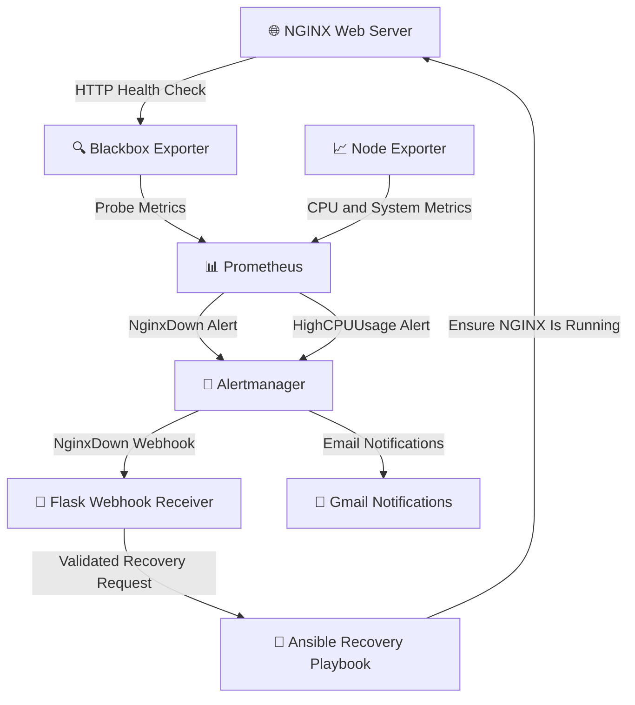
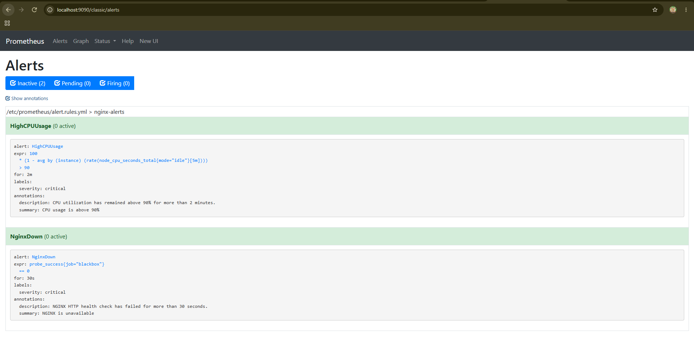
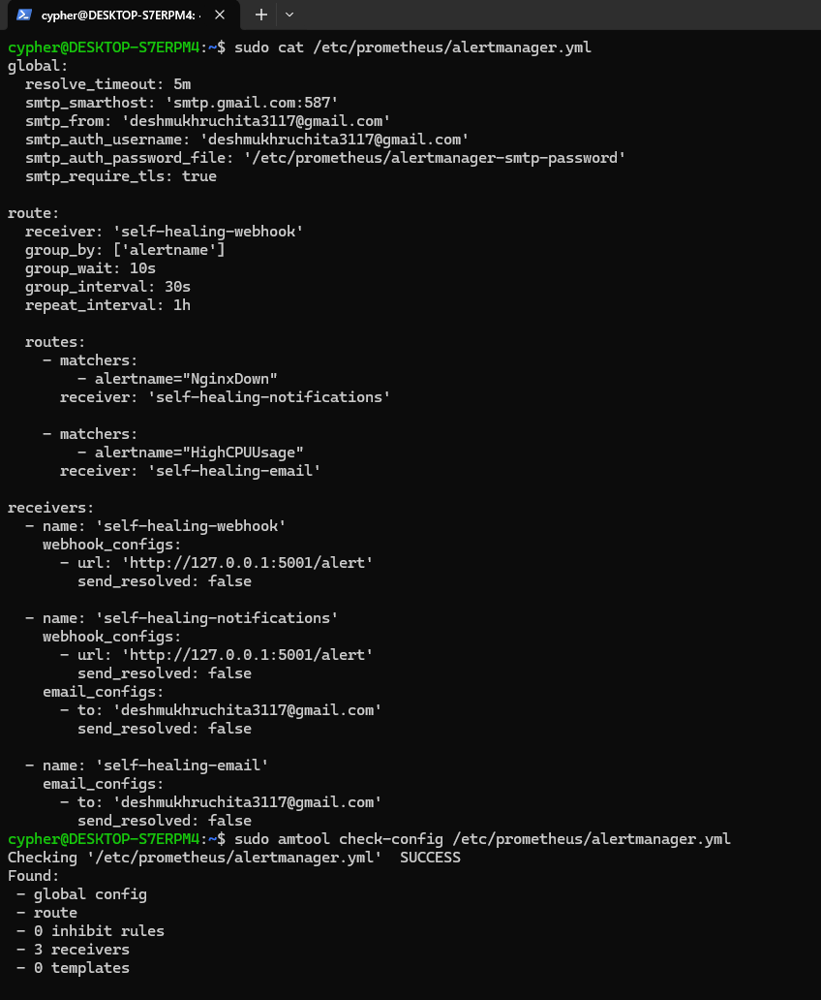
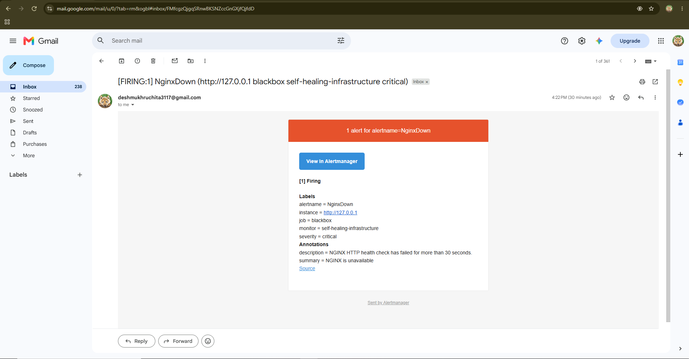
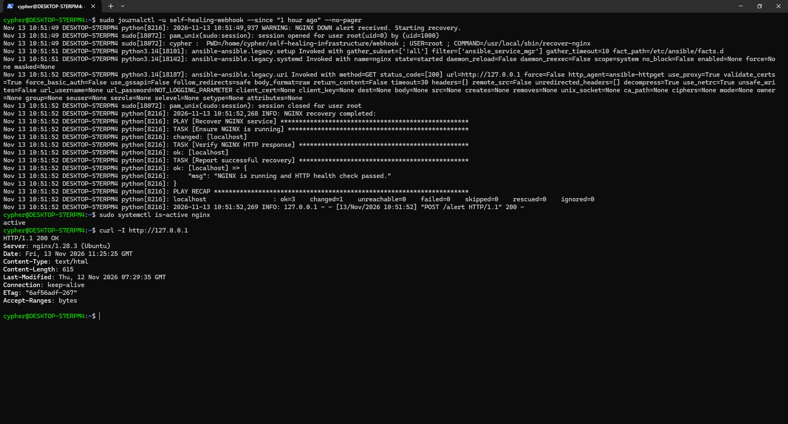

# 🚀 Self-Healing Infrastructure Using Prometheus, Alertmanager, Flask & Ansible


## 📌 Project Overview

This project demonstrates how to build a **Self-Healing Infrastructure** system using Prometheus, Alertmanager, Flask, Ansible, and NGINX.

The solution continuously monitors NGINX availability and system resource utilization. When an NGINX outage is detected, Prometheus triggers an alert, Alertmanager forwards it to a Flask webhook, and Ansible automatically executes the recovery playbook to restore the service.

🎯 **Goal:** Automate infrastructure monitoring, failure detection, alert notifications, and service recovery using open-source DevOps tools.

---

## 🎯 Project Objectives

- ✅ Monitor NGINX service availability using Blackbox Exporter.
- 📊 Collect CPU and system metrics using Node Exporter.
- 🚨 Configure Prometheus alert rules for infrastructure monitoring.
- ⚙️ Implement alert routing using Alertmanager.
- 🐍 Develop a Flask webhook to receive and validate alerts.
- 🤖 Automate NGINX recovery using Ansible.
- 📧 Configure Gmail SMTP for email notifications.
- 🔐 Protect sensitive credentials and restrict recovery execution.
- 📸 Document the implementation with project screenshots.

---

## 🛠️ Technology Stack

| Technology | Purpose |
|---|---|
| 🐧 Ubuntu on WSL2 | Operating environment |
| 🌐 NGINX | Web server |
| 🔍 Blackbox Exporter | HTTP availability monitoring |
| 📊 Prometheus | Metrics collection and alert evaluation |
| 🚨 Alertmanager | Alert routing and notification management |
| 📈 Node Exporter | CPU and system metrics |
| 🐍 Python | Application development |
| ⚗️ Flask | Webhook receiver and alert validation |
| 🤖 Ansible | Automated service recovery |
| 📧 Gmail SMTP | Email notifications |
| 🔧 Git | Version control |
| 🐙 GitHub | Source code hosting |

---

## 🏗️ Architecture Diagram



---

## 🔄 Automated Recovery Workflow

1. **🔍 Infrastructure Monitoring:** Blackbox Exporter continuously checks the NGINX HTTP endpoint.
2. **🚨 Failure Detection:** Prometheus detects failed health checks and triggers the `NginxDown` alert.
3. **📡 Alert Routing:** Alertmanager forwards the firing alert to the Flask webhook endpoint.
4. **🛡️ Alert Validation:** Flask validates the alert name and firing status.
5. **🤖 Recovery Execution:** Flask invokes the predefined Ansible recovery wrapper.
6. **🔧 Service Restoration:** Ansible ensures that the NGINX service is running.
7. **✅ Health Verification:** An HTTP health check confirms that NGINX is responding successfully.
8. **📧 Email Notification:** Alertmanager sends an email notification about the NGINX outage.

---

## 📊 Monitoring and Alert Configuration

### 🌐 NGINX Availability Monitoring

- Blackbox Exporter performs HTTP health checks.
- Prometheus collects probe metrics.
- The `NginxDown` alert detects NGINX availability failures.
- Alertmanager forwards the alert to Flask and the email notification receiver.
- Ansible performs automated service recovery.

### 📈 CPU Utilization Monitoring

- Node Exporter exposes system-level metrics.
- Prometheus collects CPU utilization data.
- The `HighCPUUsage` alert evaluates CPU utilization above 90% for two minutes.
- Alertmanager routes the CPU alert to the Gmail email receiver.

⚠️ **Testing Note:** The CPU alert rule has been successfully loaded and verified in Prometheus. Actual high-CPU email delivery has not yet been demonstrated.

---

## 🔗 Project Links

- 🐙 **GitHub Repository:** [View Source Code](https://github.com/ruchi1792/self-healing-infrastructure-Elevate-labs)
- 📊 **Prometheus Dashboard:** `http://localhost:9090`
- 🚨 **Alertmanager Dashboard:** `http://localhost:9093`

---

## 📂 Project Structure

```text
self-healing-infrastructure/
│
├── ansible/
│   └── recover_nginx.yml
│
├── webhook/
│   └── app.py
│
├── evidence/
│   ├── 01-Prometheus-Targets.PNG
│   ├── 02-Prometheus-Alert-Rules.PNG
│   ├── 03-Alertmanager-Configuration.PNG
│   ├── 04-Gmail-NginxDown-Alert.PNG
│   ├── 05-Ansible-Recovery-Logs.PNG
│   └── 06-CPU-Monitoring.PNG
│
├── .gitignore
└── README.md
```

---

## 💻 Project Implementation and Verification

### 📋 Prerequisites

Install and configure the following tools in Ubuntu on WSL2:

- Ubuntu
- NGINX
- Prometheus
- Alertmanager
- Blackbox Exporter
- Node Exporter
- Python and Flask
- Ansible
- Git

### 1️⃣ Verify NGINX Service

```bash
sudo systemctl status nginx
```

### 2️⃣ Verify Prometheus Service

```bash
sudo systemctl status prometheus
```

### 3️⃣ Verify Alertmanager Service

```bash
sudo systemctl status prometheus-alertmanager
```

### 4️⃣ Verify Flask Webhook Service

```bash
sudo systemctl status self-healing-webhook
```

### 5️⃣ Verify Ansible Recovery Playbook

```bash
sudo -n /usr/local/sbin/recover-nginx
```

### 6️⃣ Verify NGINX HTTP Response

```bash
curl http://127.0.0.1
```

### 7️⃣ Verify Prometheus Targets

Open the Prometheus targets page:

```text
http://localhost:9090/targets
```

### 8️⃣ Verify Alertmanager

Open the Alertmanager dashboard:

```text
http://localhost:9093
```

### 9️⃣ Verify NGINX Recovery Status

```bash
sudo systemctl is-active nginx
```

Expected output:

```text
active
```

---

## 🔐 Alertmanager Email Configuration

Gmail SMTP is configured to deliver infrastructure alert notifications.

The configuration uses:

- 📧 Gmail SMTP server: `smtp.gmail.com`
- 🔒 SMTP port: `587`
- 🔐 STARTTLS encryption
- 🛡️ Protected SMTP credential file
- 🚨 Alertmanager email receivers

Sensitive SMTP credentials are stored outside the Git repository and are not included in the project source code.

---

## 📸 Project Screenshots

The following screenshots demonstrate the monitoring configuration, alerting setup, email notification, automated recovery, and CPU monitoring.

### 1. 🎯 Prometheus Monitoring Targets

Displays the configured Prometheus targets and their monitoring status.


### 2. 🚨 Prometheus Alert Rules

Shows the configured alert rules, including `NginxDown` and `HighCPUUsage`.



### 3. ⚙️ Alertmanager Configuration

Demonstrates the Alertmanager receiver configuration and webhook routing.



### 4. 📧 Gmail NGINX Alert Notification

Evidence of the NGINX outage notification successfully delivered through Gmail.



### 5. 🤖 Ansible Automated Recovery Logs

Shows the Ansible recovery execution and successful task results.



### 6. 📈 Prometheus CPU Monitoring

Displays CPU utilization monitoring through Prometheus.


---

## 🏆 Project Results

- ✅ Successfully configured infrastructure monitoring using Prometheus.
- ✅ Implemented NGINX availability monitoring through Blackbox Exporter.
- ✅ Configured CPU monitoring using Node Exporter.
- ✅ Created and verified Prometheus alert rules.
- ✅ Integrated Alertmanager with Flask webhook notifications.
- ✅ Implemented automated NGINX recovery using Ansible.
- ✅ Verified successful NGINX service restoration.
- ✅ Successfully received Gmail notification for an NGINX outage.
- ✅ Documented project implementation with screenshots.

---

## 🔐 Security Best Practices

- Never commit passwords, SMTP credentials, API keys, or private keys.
- Store sensitive credentials in protected files outside the Git repository.
- Apply appropriate file permissions to credential files.
- Use `.gitignore` to exclude secrets and temporary files.
- Validate incoming webhook alerts before executing recovery operations.
- Restrict automated recovery permissions to predefined operations.
- Review screenshots and configuration files before publishing the repository.

---

## 🔮 Future Improvements

- 📊 Integrate Grafana for advanced infrastructure dashboards.
- 📧 Expand email notification and alert management capabilities.
- 🔔 Add additional service availability monitoring.
- 🤖 Extend automated recovery to other infrastructure services.
- 📈 Add historical performance analysis and monitoring reports.
- ☁️ Explore cloud-based infrastructure monitoring and recovery.

---

## 👩‍💻 Author

Created as part of a **DevOps Internship Project** focused on infrastructure monitoring, alert management, and automated recovery using open-source technologies.

---

⭐ **If you find this project useful, consider starring the repository!**

*Building reliable infrastructure through monitoring, automation, and self-healing operations.*
