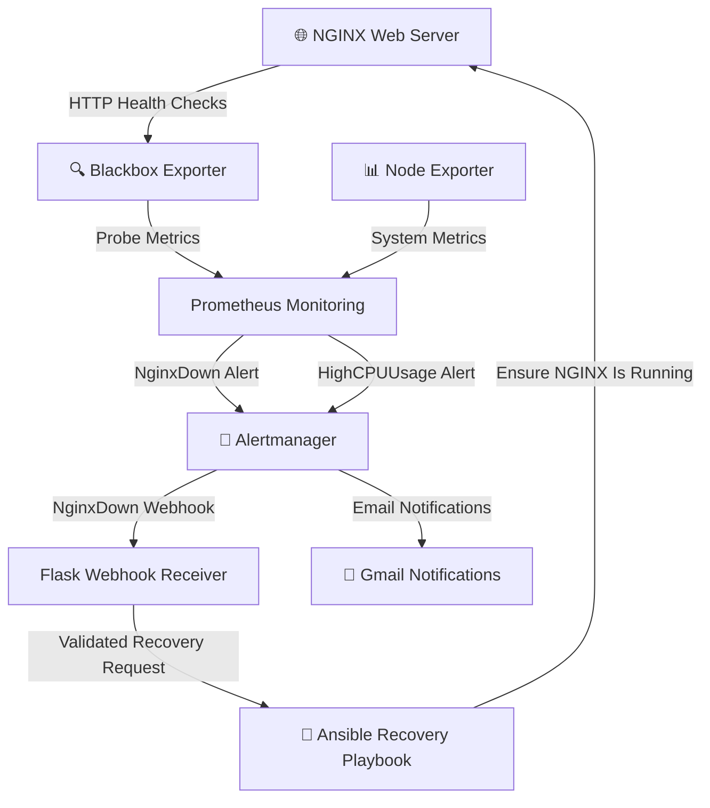
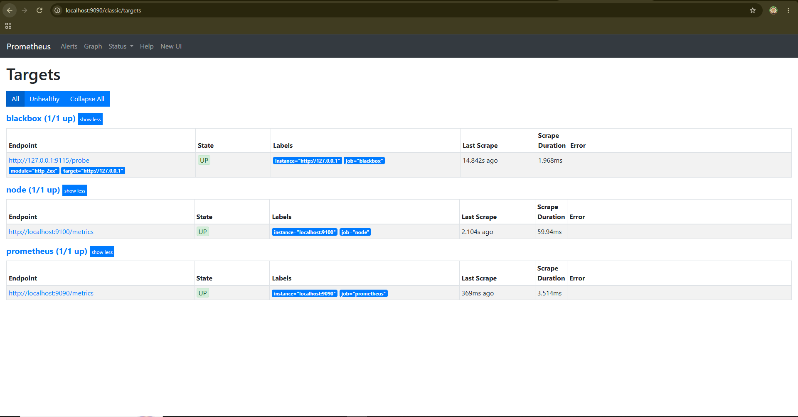
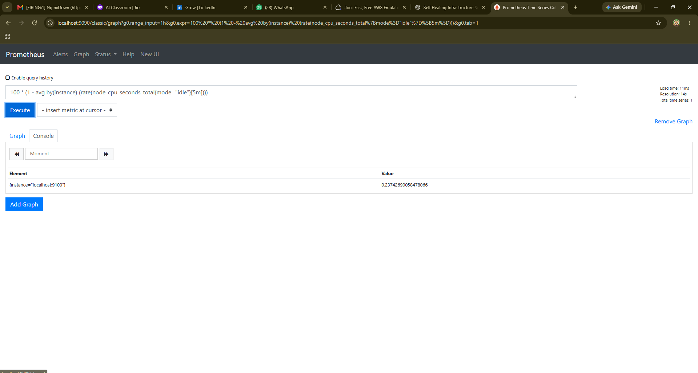

# 🛠️ Self-Healing Infrastructure

### Automated Infrastructure Monitoring, Alerting & Recovery

An infrastructure automation project designed to monitor service availability, detect failures, generate alerts, and perform automated service recovery using **Prometheus, Alertmanager, Flask, Ansible, and NGINX**.

---

## 📌 1. Project Overview

The **Self-Healing Infrastructure** project demonstrates how monitoring and automation tools can be integrated to detect infrastructure failures and initiate recovery actions with minimal manual intervention.

The system continuously monitors NGINX availability and system resource utilization. When an NGINX outage is detected, an automated alerting and recovery workflow is triggered to restore the service.

### ✨ Key Features

- 🔍 **Infrastructure Monitoring** – Continuous NGINX availability monitoring.
- 📊 **Metrics Collection** – CPU and system metrics using Node Exporter.
- 🚨 **Automated Alerting** – Prometheus alert rules with Alertmanager integration.
- 📧 **Email Notifications** – Gmail SMTP-based alert notifications.
- 🤖 **Automated Recovery** – Ansible-based NGINX service recovery.
- 🛡️ **Alert Validation** – Flask webhook validates incoming recovery alerts.
- ✅ **Health Verification** – HTTP checks confirm service availability after recovery.

---

## 🏗️ 2. System Architecture

### High-Level Architecture

**NGINX → Blackbox Exporter → Prometheus → Alertmanager → Flask Webhook → Ansible → NGINX Recovery**

### Detailed Architecture Diagram



---

## ⚙️ 3. Technology Stack

| Technology | Description |
|---|---|
| 🐧 Ubuntu on WSL2 | Operating environment |
| 🌐 NGINX | Web server |
| 🔍 Blackbox Exporter | HTTP endpoint monitoring |
| 📊 Prometheus | Metrics collection and alert evaluation |
| 🚨 Alertmanager | Alert routing and notification management |
| 📈 Node Exporter | System and CPU metrics |
| 🐍 Python | Application development |
| ⚗️ Flask | Webhook receiver and alert validation |
| 🤖 Ansible | Automated service recovery |
| 📧 Gmail SMTP | Email notifications |
| 🐙 Git & GitHub | Version control and repository hosting |

---

## 🔄 4. Automated Recovery Workflow

The automated NGINX recovery process consists of the following stages:

1. 🔍 **Monitoring:** Blackbox Exporter continuously checks the NGINX HTTP endpoint.
2. 🚨 **Failure Detection:** Prometheus detects failed health checks and triggers the `NginxDown` alert.
3. 📡 **Alert Routing:** Alertmanager forwards the firing alert to the Flask webhook endpoint.
4. 🛡️ **Alert Validation:** Flask validates the incoming alert name and status.
5. 🤖 **Recovery Execution:** Flask invokes the predefined Ansible recovery wrapper.
6. 🔧 **Service Restoration:** Ansible ensures that the NGINX service is running.
7. ✅ **Health Verification:** An HTTP health check confirms that NGINX is responding successfully.

---

## 📊 5. Monitoring and Alerting

### 🌐 NGINX Availability Monitoring

- Uses Blackbox Exporter to perform HTTP health checks.
- Prometheus collects probe metrics.
- The `NginxDown` alert detects NGINX availability failures.
- Alertmanager routes the alert to the Flask webhook and email receiver.

### 📈 CPU Utilization Monitoring

- Node Exporter exposes system-level metrics.
- Prometheus collects CPU utilization data.
- The `HighCPUUsage` rule evaluates CPU utilization above 90% for two minutes.
- Alertmanager routes the CPU alert to the email receiver.

**Validation note:** The CPU alert rule has been loaded and verified in Prometheus. Actual high-CPU email delivery has not yet been demonstrated.

---

## 📸 6. Project Evidence & Screenshots

The following screenshots document the monitoring configuration, alerting setup, notification delivery, recovery execution, and CPU monitoring.

### 6.1 🎯 Prometheus Monitoring Targets

Displays the configured Prometheus targets and their monitoring status.



### 6.2 🚨 Prometheus Alert Rules

Shows the configured alert rules, including `NginxDown` and `HighCPUUsage`.


### 6.3 ⚙️ Alertmanager Configuration

Demonstrates the Alertmanager receiver configuration and webhook routing.


### 6.4 📧 Gmail Alert Notification

Evidence of the NGINX outage notification successfully delivered through Gmail.


### 6.5 🤖 Ansible Automated Recovery Logs

Demonstrates the Ansible recovery execution and successful task results.


### 6.6 📈 Prometheus CPU Monitoring

Displays CPU utilization monitoring through the Prometheus interface.



---

## 📁 7. Repository Structure

```text
self-healing-infrastructure/
│
├── ansible/
│   └── recover_nginx.yml
│
├── webhook/
│   └── app.py
│
├── evidence/
│   ├── 01-Prometheus-Targets.PNG
│   ├── 02-Prometheus-Alert-Rules.PNG
│   ├── 03-Alertmanager-Configuration.PNG
│   ├── 04-Gmail-NginxDown-Alert.PNG
│   ├── 05-Ansible-Recovery-Logs.PNG
│   └── 06-CPU-Monitoring.PNG
│
├── .gitignore
└── README.md
```

---

## 🧪 8. Testing and Validation

The NGINX automated recovery workflow was tested by deliberately stopping the NGINX service.

The following results were verified:

- ✅ NGINX outage detected by the monitoring system.
- ✅ `NginxDown` alert successfully triggered.
- ✅ Alertmanager delivered the webhook to Flask.
- ✅ Flask validated the incoming alert.
- ✅ Ansible recovery playbook executed successfully.
- ✅ NGINX service restored to the active state.
- ✅ HTTP health check confirmed successful recovery.
- ✅ Gmail notification received for the NGINX outage.
- ✅ CPU alert rule loaded and verified in Prometheus.

**Testing limitation:** Actual high-CPU email delivery has not yet been demonstrated.

---

## 🔐 9. Security Considerations

- Never commit passwords, SMTP credentials, API keys, or private keys.
- Store sensitive credentials in protected files outside the Git repository.
- Apply appropriate file permissions to credential files.
- Use `.gitignore` to exclude secrets, virtual environments, and temporary files.
- Review source files and screenshots before publishing the repository.
- Restrict webhook and recovery execution permissions to authorized operations.

---

## 🎯 10. Project Outcome

This project demonstrates the practical implementation of **self-healing infrastructure principles** through monitoring, alert management, webhook integration, and configuration automation.

By integrating Prometheus, Alertmanager, Flask, and Ansible, the solution provides an automated mechanism to detect NGINX outages, initiate recovery, and verify service restoration.

### 🚀 Skills Demonstrated

- Infrastructure Monitoring
- Prometheus Alerting
- Alertmanager Configuration
- Linux Service Management
- Python and Flask Development
- Ansible Automation
- Webhook Integration
- SMTP Email Notifications
- Git and GitHub Version Control

---

### ⭐ Technologies Used

**Prometheus | Alertmanager | NGINX | Flask | Ansible | Blackbox Exporter | Node Exporter | Python | Ubuntu | GitHub**

*Building reliable infrastructure through monitoring, automation, and self-healing operations.*
